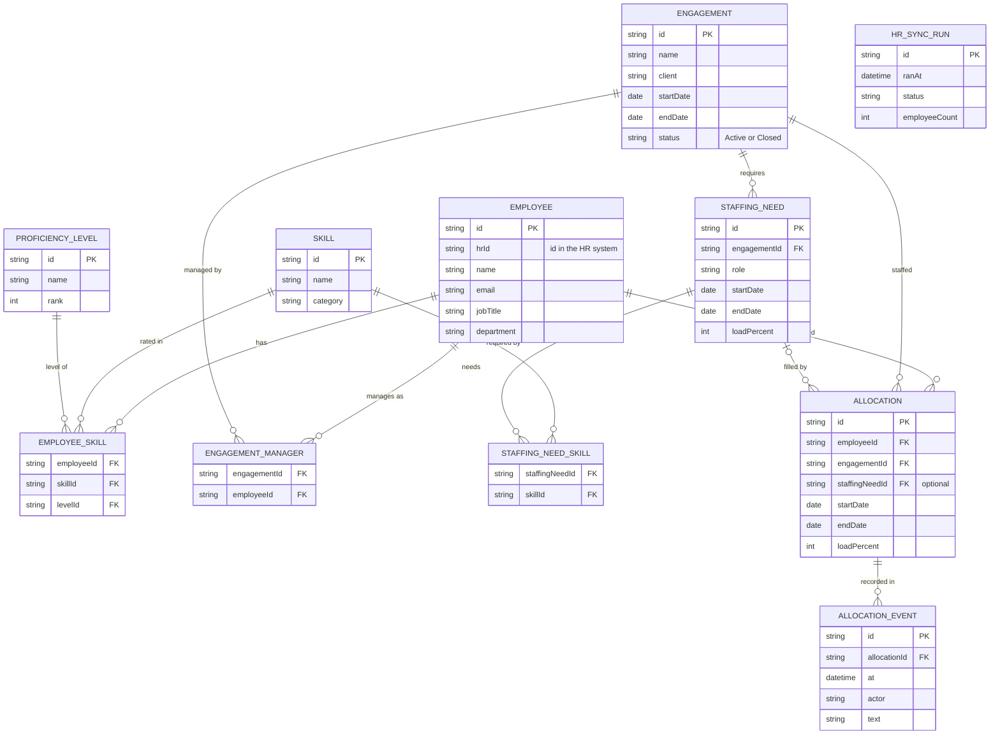

# Data model

Employees come from the HR system; skills, engagements, staffing needs and allocations are owned by this app.

An employee is created and updated only by the HR synchronisation. A staffing need counts as filled when its allocations cover its dates and load. Over-allocation (total load above 100% in a period) is derived from allocations, not stored.